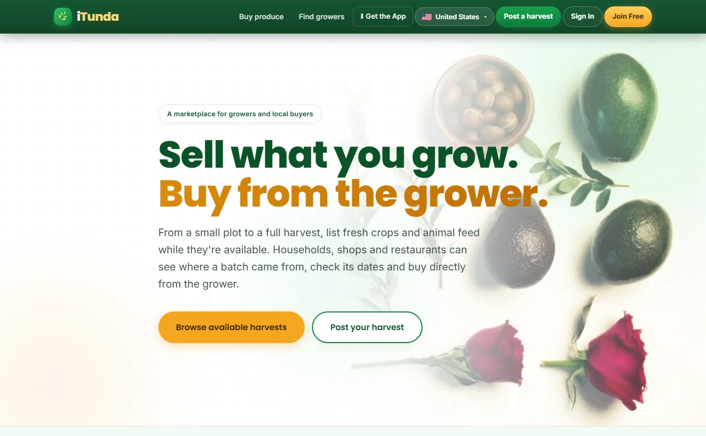
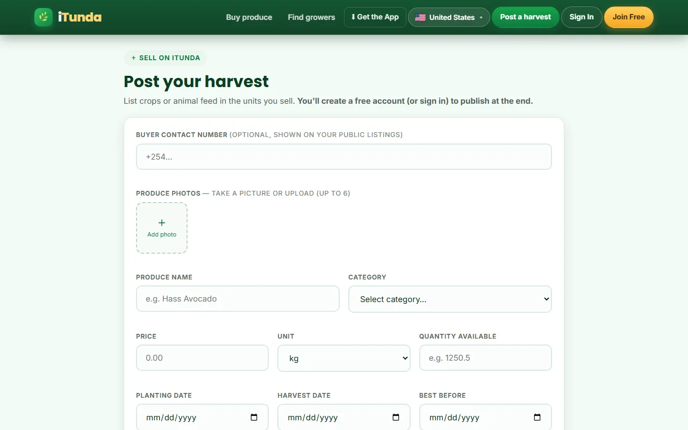

# iTunda

*Sell what you grow. Buy from the grower.*

[Visit iTunda](https://itunda.org/) · [Repository guide](#repository-guide)

## Idea

A marketplace for buying crops and feed directly from the people who grow them.

## Overview

Growers of any size can post available crops or feed, with quantities, location, and a pickup or freshness window. Grocers, small shops, restaurants, and households can look for stock that fits their needs.

The grower and buyer can talk directly. Keeping the grower, location, and harvest details with the listing gives buyers a clearer idea of where the produce came from and helps growers build repeat orders.

## Screenshots

**[iTunda homepage](https://itunda.org/)**



**[Post your harvest](https://itunda.org/sell)**



## Repository guide

### 🧱 Repository structure

```
iTunda/
├── iTunda.Api/   ASP.NET Core 8 Web API (EF Core + SQLite, JWT auth)
├── iTunda.App/   .NET MAUI app (Windows / Android / iOS / macOS)
├── iTunda.Web/   React 19 + Vite + TypeScript SPA
├── auth-server/  Node/Express Google-sign-in sidecar (PostgreSQL sessions)
└── iTunda.sln
```

#### Tech stack

- **API** — ASP.NET Core 8, EF Core (SQLite), JWT bearer auth, BCrypt, Swagger. Seeds ~1,000
  produce listings + spot/limit/futures/put orders across 26 farmers/regions and **26 commodities**
  on first run.
- **Web** — React 19, Vite, TypeScript, React Router, Axios, Leaflet (maps), FlagCDN (flags),
  `@react-oauth/google` (Google sign-in) and a live currency context (open.er-api.com rates).
- **Auth** — a small Node/Express sidecar verifies Google credentials (`google-auth-library`) and
  issues PostgreSQL-backed sessions; IIS proxies `/gauth/*` to it.
- **App** — .NET MAUI (net10.0), C# code-behind UI, shared REST client; shipped as a signed Android APK.
- **Design** — white-on-green brand system, Poppins + Inter, harvest-gold accent, red/green BUY-SELL.

#### Key API endpoints

| Endpoint | Auth | Purpose |
| --- | --- | --- |
| `GET /api/produce` | public | Listings, filterable by `category`, `region`, `country`, `zone`, `exportReady` |
| `POST /api/produce` | farmer | Create a listing (requires photos, planting + best-before dates, farm GPS) |
| `GET /api/regions` | public | Growing regions + export zones with live listing counts |
| `GET /api/commodities` | public | Price board (avg / low / high / daily change) for the ticker |
| `GET /api/buyorders` · `POST /api/buyorders` | public | Read / post orders, filterable by `side` + `kind` (spot/limit/futures/put) |
| `POST /api/delivery/estimate` | public | Route distance, ETA and freight price between two points |
| `POST /gauth/google` · `GET /gauth/me` | public | Google sign-in — verify credential, issue/read a session |

---

### 🎨 Design system

Fresh farm palette — deep forest greens with a harvest-gold call-to-action.

| Token | Value | Use |
| --- | --- | --- |
| Primary green | `#0E7A3E` | Buttons, headings |
| Deep green | `#0A4A26` | Nav bar, hero, footer |
| Fresh green | `#16A34A` | Highlights, links |
| Harvest gold | `#F4A621` | Primary CTAs, prices |
| Page tint | `#F3FAF5` | Backgrounds |

Fonts: **Poppins** (headings) + **Inter** (body).

---

### 🚀 Local development

#### Prerequisites
- .NET 10 SDK (with the `maui` workloads for the app)
- Node.js 20+

#### 1. API
```bash
cd iTunda.Api
dotnet run
# → http://localhost:5041 (Swagger at /swagger). SQLite DB + seed data are created automatically.
```

#### 2. Web
```bash
cd iTunda.Web
npm install
npm run dev
# → http://localhost:3000  (Vite proxies /api → the local API)
```

#### 3. Mobile app (Windows)
```bash
cd iTunda.App
dotnet build -f net10.0-windows10.0.19041.0
# or open iTunda.sln in Visual Studio and run the iTunda.App (Windows Machine) target
```
Demo login (any seeded account, password `Password123!`):
`james.kamau@farm.ke` (farmer) · `orders@nairobifresh.ke` (buyer).

---

### 🌐 Production hosting (this server)

iTunda is deployed on IIS (Windows Server) behind Cloudflare, following the same pattern as
the other sites on the box:

- **API** runs as a Windows service (`itunda-api`, via NSSM) on `http://127.0.0.1:5088`.
- **Auth sidecar** runs as a Windows service (`itunda-auth`, via NSSM) on `http://127.0.0.1:3019`
  and handles Google sign-in against PostgreSQL.
- **Web** is built with Vite (`dist/`) and served by the IIS site `itunda.org` from
  `C:\inetpub\wwwroot\itunda.org`.
- `iTunda.Web/public/web.config` gives the SPA a fallback route, **proxies `/api` → the API
  service** and **`/gauth` → the auth sidecar**, and adds an `.apk` MIME map so the Android build is
  served from `/dl/itunda.apk`. The browser only ever talks to `https://itunda.org`.

> **Google sign-in origins:** the client ID lives in the `petezdj` GCP project ("Web client 1").
> `https://itunda.org` (and `https://www.itunda.org`) must be listed under *Authorised JavaScript
> origins* for the button to render. Google does not allow plain `http://` origins, so Cloudflare's
> *Always Use HTTPS* upgrades `http://itunda.org` visitors to the working HTTPS origin.

Rebuild and redeploy the web app at any time with:

```powershell
# from the repo root
powershell -File publish.ps1          # build + deploy to wwwroot
powershell -File publish.ps1 -Install  # also refresh npm dependencies
```

To (re)publish the API service:

```powershell
dotnet publish iTunda.Api -c Release -r win-x64 --self-contained true -o C:\inetpub\apps\itunda-api
nssm restart itunda-api
```

---

### 📄 License

© iTunda — Global Farm-to-Fork Commodity Marketplace.


### Mobile App (React Native)


**iTunda for Android** is a native mobile app built with **React Native (Expo)** -- trade fresh produce farm-to-futures - buy, sell, bid and track deliveries from your phone.

**[Download the Android app](https://itunda.org/dl/itunda.apk)**

- **Source:** [`itunda-rn/`](itunda-rn) -- the full Expo Router + TypeScript project.
- **Stack:** Expo SDK 57, Expo Router, TypeScript, React Native, AsyncStorage.
- Runs on Android 7.0+ (arm64 / armv7). You may need to allow *install from unknown sources*.

<br clear="left" />
